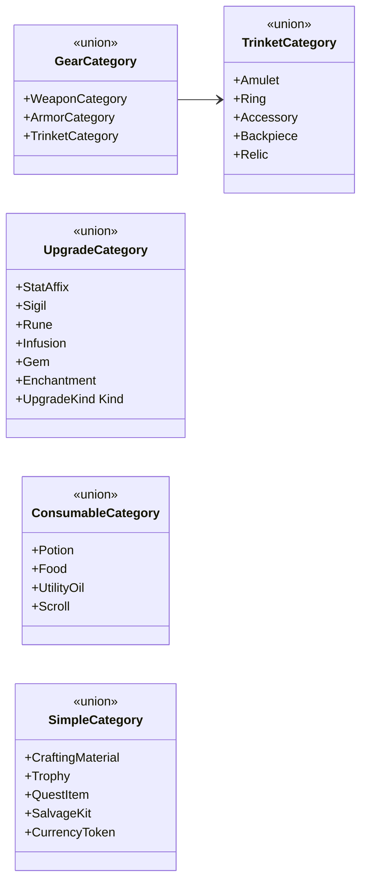

# Domain-Scoped Item Category Unions

```text
         ┌───────────────────────────────────────────────────────────────────────┐
         │                   Domain-Scoped Category Unions                       │
         └───────────────────────────────────┬───────────────────────────────────┘
                                             │
        ┌────────────────────┬───────────────┴───────┬────────────────────┐
        ▼                    ▼                       ▼                    ▼
┌───────────────┐    ┌───────────────┐       ┌───────────────┐    ┌───────────────┐
│ GearCategory  │    │UpgradeCategory│       │  Consumable   │    │SimpleCategory │
│    (Gear)     │    │ (GearUpgrade) │       │   Category    │    │ (SimpleItem)  │
└───────┬───────┘    └───────┬───────┘       └───────┬───────┘    └───────┬───────┘
        │                    │                       │                    │
        ├─ WeaponCategory    ├─ StatAffix            ├─ Potion            ├─ CraftingMaterial
        │  (Sword..Rifle)    ├─ Sigil                ├─ Food              ├─ Trophy
        ├─ ArmorCategory     ├─ Rune                 ├─ UtilityOil        ├─ QuestItem
        │  (Weight + Piece)  ├─ Infusion             └─ Scroll            ├─ SalvageKit
        └─ TrinketCategory   ├─ Gem                                       └─ CurrencyToken
           ├─ Amulet         └─ Enchantment
           ├─ Ring
           ├─ Accessory
           ├─ Backpiece
           └─ Relic
```


