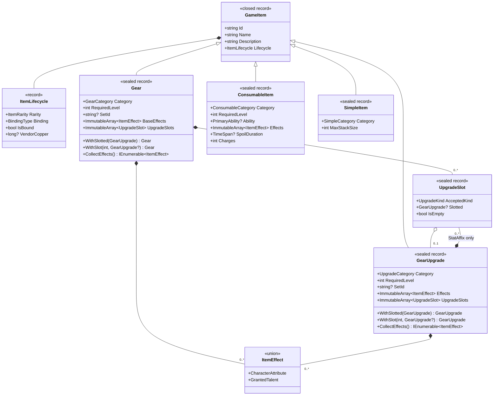

# Item Hierarchy & Slot Architecture

```text
                        ┌──────────────────────────────────────────────┐
                        │           closed record GameItem             │
                        │──────────────────────────────────────────────│
                        │ + Id: string                                 │
                        │ + Name: string                               │
                        │ + Description: string                        │
                        │ + Lifecycle: ItemLifecycle                   │
                        └──────────────────────┬───────────────────────┘
                                               │
        ┌──────────────────────┬───────────────┴───────┬──────────────────────┐
        ▼                      ▼                       ▼                      ▼
┌───────────────┐    ┌───────────────────┐   ┌───────────────────┐   ┌─────────────────┐
│     Gear      │    │    GearUpgrade    │   │  ConsumableItem   │   │   SimpleItem    │
│───────────────│    │───────────────────│   │───────────────────│   │─────────────────│
│ GearCategory  │    │ UpgradeCategory   │   │ ConsumableCategory│   │ SimpleCategory  │
│ RequiredLevel │    │ RequiredLevel     │   │ RequiredLevel     │   │ MaxStackSize    │
│ SetId?        │    │ SetId?            │   │ Ability?          │   └─────────────────┘
│ BaseEffects   │    │ Effects           │   │ Effects           │
│ UpgradeSlots ─┼───►│ UpgradeSlots ─────┼─┐ │ SpoilDuration?    │
└───────────────┘    └───────────────────┘ │ │ Charges           │
                               ▲           │ └───────────────────┘
                               └───────────┘
                           (StatAffix slots only)

┌─────────────────────────────────────────────────────────────────────────────────────────┐
│                                 Composed Value Objects                                  │
├───────────────────────────────────────────┬─────────────────────────────────────────────┤
│   UpgradeSlot & ItemEffect                │   ItemLifecycle (Shared Economy & Binding)  │
│───────────────────────────────────────────│─────────────────────────────────────────────│
│ • UpgradeSlot(AcceptedKind, Slotted?)     │ • Rarity: ItemRarity                        │
│ • ItemEffect:                             │ • Binding: BindingType                      │
│   ├─ CharacterAttribute (StatValue<double>)│ • IsBound: bool                            │
│   └─ GrantedTalent(Talent)                │ • VendorCopper: long?                       │
│                                           │                                             │
│ • ItemSetDefinition(SetId, Name, Tiers)   │   EquipmentAggregator.Aggregate(...)        │
│ • SetBonusTier(RequiredPieces, Effects)   │   ├─► AggregatedAttributes (StatValue +)    │
│                                           │   ├─► GrantedTalents (Talent[])             │
│                                           │   └─► ActiveSetPieceCounts                │
└───────────────────────────────────────────┴─────────────────────────────────────────────┘
```


